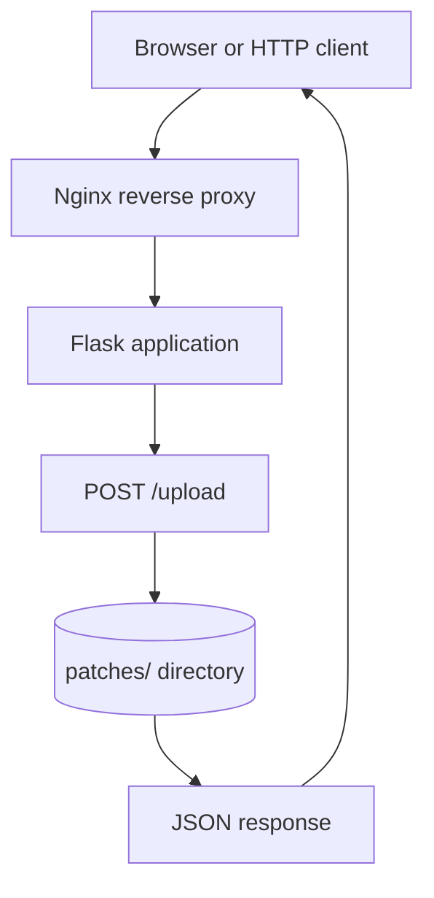

<!-- Documentation-only refresh: README.md. -->

<div align="center">

  

  <p><strong>A small web-based prototype for receiving and storing patch files.</strong></p>

  <p>
    <a href="https://kernel-server-1.onrender.com/"></a>
    <a href="https://github.com/dieudonne670/kernel-server"></a>
  </p>

  <p>
    
    
    
    
  </p>

</div>

---

## 🧠 Overview

**LivePatch Kernel** is an experimental web-based patch upload prototype. Its current Flask application provides a simple upload page and a POST endpoint that accepts a file under the `patch` form field and saves it into a local `patches/` directory.

The repository also includes a Dockerfile and an Nginx reverse-proxy configuration. The project explores how a small web service can be packaged and exposed behind a reverse proxy.

**Hosted demo:** [kernel-server-1.onrender.com](https://kernel-server-1.onrender.com/)

> **Important scope clarification:** The current checked-in implementation is a basic file-upload prototype. It does not yet implement safe patch validation, cryptographic verification, authenticated agent communication, kernel module installation, fleet orchestration, or automatic operating-system patch deployment. Those are future engineering directions, not current capabilities.

## ✨ Current implementation

- Flask route for the upload interface (`GET /`).
- Flask upload endpoint (`POST /upload`).
- Checks whether a file was included in the request.
- Saves the uploaded file in the `patches/` directory.
- Returns a JSON success or error response.
- Docker image definition.
- Nginx reverse-proxy configuration.
- Shell script to start Nginx and the Flask application.

## 🏗️ Request flow



The current Nginx configuration forwards incoming requests to the Flask service on port 10000.

## 🧰 Technology stack

| Technology | Purpose in this repository |
| --- | --- |
| Python | Application language |
| Flask | Upload page and HTTP endpoint |
| Nginx | Reverse proxy |
| Docker | Container packaging |
| Jinja2 | HTML template rendering |
| Gunicorn | Included in the Python requirements for WSGI serving; the current run script starts Flask directly |

**FastAPI note:** FastAPI appears in the dependency list and in the original architecture concept, but a corresponding FastAPI application entry point was not present at the inspected `server/main.py` path. The current README therefore does not describe a working FastAPI microservice.

## 🗂️ Project structure

```text
kernel-server/
├── server/
│   ├── livepatch_server.py  # Flask application
│   ├── templates/           # Upload interface templates
│   ├── patches/             # Uploaded patch storage at runtime
│   ├── Dockerfile           # Container definition
│   ├── nginx.conf           # Reverse proxy configuration
│   ├── run.sh               # Starts Nginx and Flask
│   └── requirements.txt     # Python dependencies
└── README.md
```

## ⚙️ Run locally

### Prerequisites

- Python 3.10+
- pip
- Docker (optional, for containerized execution)

### Run the Flask application directly

```bash
git clone https://github.com/dieudonne670/kernel-server.git
cd kernel-server/server

python3 -m venv .venv
source .venv/bin/activate

pip install -r requirements.txt
python livepatch_server.py
```

The Flask development server listens on port `10000` according to the application entry point.

### Build and run the Docker image

From the `server/` directory:

```bash
docker build -t livepatch .
docker run --rm -p 8080:80 -p 10000:10000 livepatch
```

The container's Nginx configuration listens on port 80 and proxies requests to the Flask process on port 10000.

## ☁️ Hosted demo

The repository documents a Render deployment:

[https://kernel-server-1.onrender.com/](https://kernel-server-1.onrender.com/)

The live demo link does not imply that uploaded files are stored durably or that the service is suitable for receiving real software patches.

## 🔐 Security limitations

File upload services require strong safeguards. The current upload handler uses the submitted filename to construct a filesystem path and does not show authentication, authorization, file type validation, size limits, malware scanning, signature verification or safe storage isolation.

Before accepting untrusted files or using this design for real patch distribution, implement:

- Authentication and authorization for uploaders and agents.
- Strict filename handling and path traversal protection.
- File size and file type restrictions.
- Content inspection and malware scanning.
- Cryptographic checksums and trusted digital signatures.
- Non-executable, isolated patch storage.
- Audit logs and upload rate limits.
- A controlled patch approval, rollout and rollback process.
- Persistent storage and backup policies.

Never execute uploaded files directly.

## 🛣️ Roadmap

- [ ] Add authenticated upload and agent identities.
- [ ] Validate filenames, file sizes and allowed file formats.
- [ ] Add checksum and digital-signature verification.
- [ ] Implement patch metadata and version tracking.
- [ ] Add a real agent registration and synchronization API.
- [ ] Build a FastAPI service only when the separate service is implemented and tested.
- [ ] Add patch approval and rollback workflows.
- [ ] Add automated tests and CI checks.
- [ ] Improve deployment logging, monitoring and persistent storage.

## 💡 Engineering concepts explored

This project is a starting point for learning about:

- HTTP file uploads with Flask.
- Reverse proxying with Nginx.
- Containerizing Python services with Docker.
- Separating an application process from its network-facing proxy.
- The security requirements of software distribution systems.

## 👨‍💻 Author

**Kindong Dieudonne**  
Software Engineering graduate · Python Backend Developer

- GitHub: [@dieudonne670](https://github.com/dieudonne670)
- LinkedIn: [Kindong Dieudonne](https://www.linkedin.com/in/kindong-dieudonne-826ba9328/)

---

<div align="center">
  <p><strong>Experimenting with the foundations of safer software update delivery.</strong></p>
</div>
